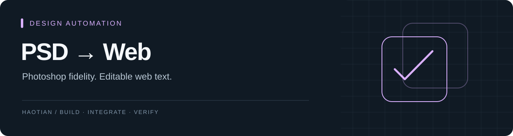

# PSD Web Converter

把 Photoshop 设计稿转换成可浏览的网页，并在支持的文字层上提供 HTML 文本编辑。

**Python · Photoshop JSX · HTML / CSS**
状态：macOS 本地原型 / 必须安装 Adobe Photoshop

## 核心取舍

复杂效果、蒙版与智能对象交给 Photoshop 渲染；工具提取结构和文字信息，以减少网页逐层复刻造成的视觉差异。

| 模式 | 输出 |
| --- | --- |
| fidelity | Photoshop 渲染图、结构化信息与网页 |
| editable | 在支持的文字层上增加可编辑 HTML 文本 |
| assets | 布局 JSON、文字 JSON 与 flatten 图片 |

这不是将任意 PSD 完整重建为响应式组件的工具。部分文字只能兼容读取，此时保留完整渲染图，编辑时再显示文字层。

## 快速开始

```sh
python3 -m psd_web_converter.web --host 127.0.0.1 --port 8787
```

浏览器打开 `http://127.0.0.1:8787`，上传自己有权使用的 PSD，选择模式，预览并下载结果。

CLI 示例：

```sh
python3 -m psd_web_converter ./input.psd ./output --mode editable
```

转换在本机执行，不调用大模型。没有 Photoshop 时会报错，不使用另一套渲染器冒充转换成功。

## 输出结构

```text
output/
├── index.html
├── layout.json
├── text-layers.json
├── report.md
└── assets/flatten.png
```

仓库提供 `photoshop-scripts/create-smoke-psd.jsx`，用于在 Photoshop 中生成简单测试稿；不包含客户 PSD 或会议素材。

→ [完整使用说明](docs/USAGE.md) · [系统地图](SYSTEM-MAP.md) · [发布检查](docs/PUBLISH-CHECKS.md)
